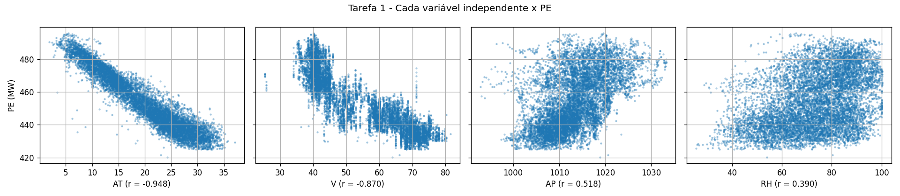
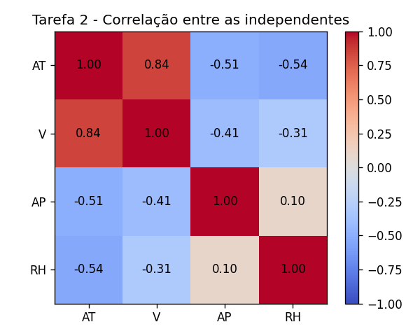
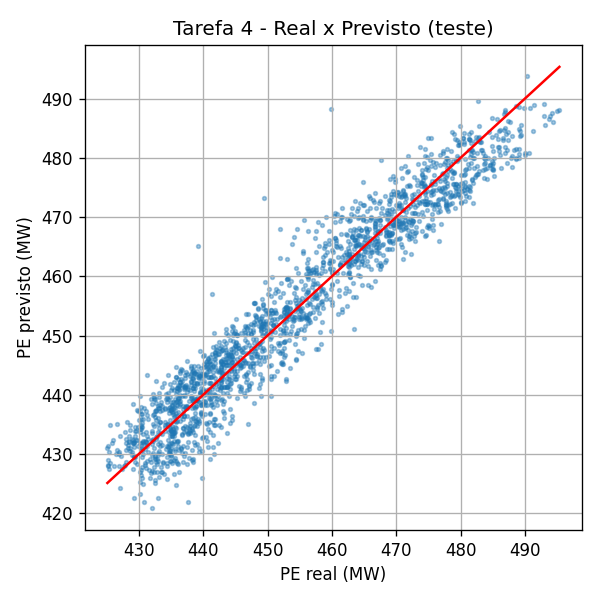

# Problema 1 — Regressão Linear Múltipla para Previsão de Produção de Energia (UTCC)

**Disciplina:** PAM0466 – Sistemas Inteligentes (2026.2) — UFERSA, Pau dos Ferros
**Dataset:** [UCI CCPP](https://archive.ics.uci.edu/ml/datasets/Combined+Cycle+Power+Plant) — 9.568 amostras
**Variáveis independentes:** AT, V, AP, RH | **Variável dependente:** PE (MW)

## Como executar

| Arquivo / pasta | Conteúdo                                                                      |
| --------------- | ----------------------------------------------------------------------------- |
| `Q1.ipynb`      | Código completo (correlações, pré-processamento, modelo, métricas e gráficos) |
| `relatorio.md`  | Este relatório                                                                |
| `imagens/`      | Gráficos gerados pelo código                                                  |

Requisitos: Python 3.9+, conexão com a internet (o dataset é baixado da UCI a cada execução). Funciona em Windows, Linux e macOS.

1. Abra o `Q1.ipynb` no Jupyter ou no VS Code.
2. Execute a primeira célula: `%pip install numpy pandas matplotlib scikit-learn ucimlrepo`
3. Execute a célula do código. Se o `ucimlrepo` não for reconhecido logo após a instalação, reinicie o kernel e execute de novo.

## 1. Pré-processamento

| Etapa                | O que foi feito                                                                      | Por quê                                                                                              |
| -------------------- | ------------------------------------------------------------------------------------ | ---------------------------------------------------------------------------------------------------- |
| Carregamento         | Dataset baixado da UCI com `ucimlrepo` (id 294): 9.568 linhas e 5 colunas numéricas. | Usa os dados originais.                                                                              |
| Valores ausentes     | Nenhum encontrado. Mesmo assim, foi aplicado `SimpleImputer` com a mediana.          | O enunciado pede o tratamento de ausentes. A mediana é robusta a valores extremos.                   |
| Divisão treino/teste | 80% treino (7.654 amostras) e 20% teste (1.914 amostras), `random_state=42`.         | O teste simula dados novos e só é usado para avaliar. A semente fixa torna o resultado reprodutível. |
| Padronização         | z-score (`StandardScaler`): `z = (x − média) / desvio padrão`.                       | Coloca as 4 variáveis na mesma escala (média 0, desvio 1), tornando os coeficientes comparáveis.     |

A mediana, a média e o desvio padrão foram calculados **somente no treino** e aplicados ao teste. Assim, nenhuma informação do teste influencia o treinamento (evita vazamento de dados).

## 2. Tarefa 1 — Correlação entre as variáveis independentes e PE

A correlação de Pearson mede a força e o sentido da relação **linear** entre duas variáveis (de −1 a +1). Sinal negativo: quando a variável sobe, PE cai.

| Variável | Correlação com PE | Intensidade                |
| -------- | ----------------- | -------------------------- |
| AT       | −0,948            | muito forte, negativa      |
| V        | −0,870            | forte, negativa            |
| AP       | +0,518            | moderada, positiva         |
| RH       | +0,390            | fraca a moderada, positiva |

**Quais variáveis parecem ter maior influência?** AT e V, que têm os maiores valores absolutos de correlação.

- **AT (temperatura ambiente):** temperatura alta reduz a densidade do ar e a eficiência da combustão, então a potência cai.
- **V (vácuo de escape):** valores altos indicam pior desempenho da turbina a vapor, então a potência cai.
- **AP e RH:** têm influência menor sobre PE.

## 3. Tarefa 2 — Correlação entre as variáveis independentes

| Par     | Correlação |
| ------- | ---------- |
| AT – V  | +0,84      |
| AT – RH | −0,54      |
| AT – AP | −0,51      |
| V – AP  | −0,41      |
| V – RH  | −0,31      |
| AP – RH | +0,10      |

**Existe relação forte entre elas?** Sim: AT e V têm correlação de 0,84. Há também correlações moderadas de AT com RH (−0,54) e com AP (−0,51).

**Isso indica multicolinearidade?** Sim. Multicolinearidade ocorre quando variáveis independentes são fortemente correlacionadas entre si, ou seja, carregam informação parecida. A consequência é que os coeficientes individuais ficam instáveis e difíceis de interpretar, enquanto a capacidade de previsão, em geral, não é prejudicada. Nenhuma variável foi removida, pois o enunciado pede o uso das quatro.

## 4. Tarefa 3 — Modelo de regressão linear múltipla

Modelo: **PE = θ₀ + θ₁·AT + θ₂·V + θ₃·AP + θ₄·RH**

Os parâmetros foram estimados por mínimos quadrados (`LinearRegression`), minimizando a soma dos quadrados dos erros, com as variáveis padronizadas do treino.

| Parâmetro       | Valor   |
| --------------- | ------- |
| Intercepto (θ₀) | 454,431 |
| AT              | −14,764 |
| V               | −2,950  |
| AP              | +0,370  |
| RH              | −2,312  |

Como as variáveis foram padronizadas, cada coeficiente indica a variação de PE, em MW, para um aumento de **1 desvio padrão** na variável, mantendo as demais fixas. O intercepto é a previsão para uma amostra com todas as variáveis na média.

**Efeito da multicolinearidade nos coeficientes:**

- **V** tem correlação de −0,87 com PE, mas coeficiente pequeno (−2,95), pois AT (correlação de 0,84 com V) já explica boa parte da mesma informação.
- **RH** tem correlação positiva com PE (+0,39), mas coeficiente negativo (−2,31). A correlação simples mistura o efeito de RH com o de AT (AT–RH = −0,54). No modelo múltiplo, o coeficiente mede o efeito de RH com as demais variáveis fixas, e o sinal inverte.
- **AP** segue a mesma lógica: correlação de +0,52 com PE, mas coeficiente pequeno (+0,37), pois AT–AP = −0,51.

## 5. Tarefa 4 — Avaliação do desempenho

| Conjunto  | R²         | RMSE (MW) | MAE (MW)  |
| --------- | ---------- | --------- | --------- |
| Treino    | 0,9283     | 4,571     | 3,630     |
| **Teste** | **0,9301** | **4,503** | **3,596** |

**Como ler as métricas:**

- **R²:** fração da variabilidade de PE explicada pelo modelo (1 = perfeito, 0 = tão ruim quanto prever sempre a média). No teste, o modelo explica cerca de 93%.
- **RMSE:** raiz do erro quadrático médio, na unidade do alvo (MW). Penaliza mais os erros grandes.
- **MAE:** erro absoluto médio, em MW. É o erro típico de cada previsão.
- **Gráfico real × previsto:** a linha vermelha é a previsão perfeita. Quanto mais próximos dela os pontos, melhor o modelo.

**O modelo é adequado para prever a produção de energia? Sim.**

1. **Boa capacidade explicativa:** R² de 0,93 no teste.
2. **Erro pequeno:** o RMSE de 4,5 MW equivale a cerca de 1% da média de PE (454 MW), e o MAE é de 3,6 MW.
3. **Generalização:** as métricas de treino e teste são praticamente iguais (R² 0,928 e 0,930), logo não há overfitting. O modelo funciona em dados que não viu.

**Limitação:** cerca de 7% da variabilidade de PE não é explicada, pois o modelo é linear e usa só variáveis ambientais. A multicolinearidade afeta a interpretação dos coeficientes, mas não a qualidade das previsões.

## 6. Conclusão

AT e V são as variáveis mais associadas à produção de energia (correlações de −0,95 e −0,87), e há forte multicolinearidade entre elas (r = 0,84). O modelo de regressão linear múltipla, com R² = 0,93 e erro médio de 3,6 MW (cerca de 1% da produção médio), é adequado para prever PE a partir de sensores ambientais.
