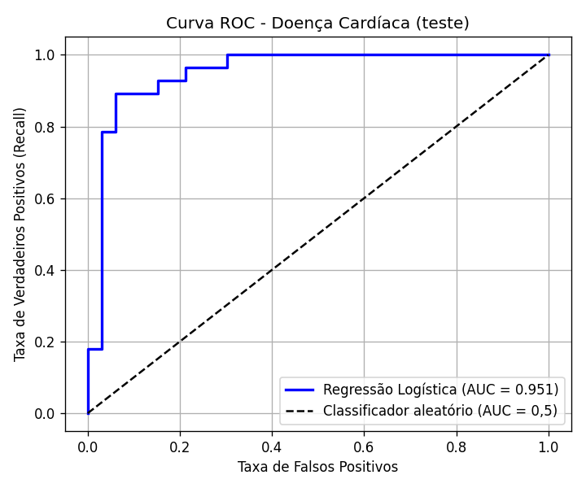

# Problema 2 — Regressão Logística para Previsão de Doenças Cardíacas

**Disciplina:** PAM0466 – Sistemas Inteligentes (2026.2) — UFERSA, Pau dos Ferros
**Dataset:** [Heart Disease – Cleveland (UCI)](https://archive.ics.uci.edu/dataset/45/heart+disease) — 303 pacientes e 13 variáveis clínicas
**Modelo:** `LogisticRegression(solver='liblinear', random_state=42, max_iter=1000)`

## Como executar

| Arquivo / pasta | Conteúdo |
| --------------- | -------- |
| `Q2.ipynb` | Código completo (pré-processamento, modelo, métricas e curva ROC) |
| `relatorio.md` | Este relatório |
| `imagens/` | Curva ROC gerada pelo código |

Requisitos: Python 3.9+ e conexão com a internet (o dataset é baixado da UCI a cada execução). Funciona em Windows, Linux e macOS.

1. Abra o `Q2.ipynb` no Jupyter ou no VS Code.
2. Execute a primeira célula: `%pip install pandas matplotlib scikit-learn`
3. Execute a célula do código.

## 1. Pré-processamento

| Etapa | O que foi feito | Por quê |
| ----- | --------------- | ------- |
| Carregamento | Arquivo `processed.cleveland.data` lido direto da UCI, com 303 linhas e 14 colunas (13 variáveis + `target`). Como o arquivo não tem cabeçalho, os nomes das colunas foram informados; `?` foi lido como valor ausente. | O arquivo original não traz nomes de colunas e usa `?` para ausentes. |
| Valores ausentes | Apenas `ca` (4 casos) e `thal` (2 casos): 6 valores em 303 linhas. Imputados pela **moda** (`SimpleImputer(strategy='most_frequent')`). | `ca` e `thal` são variáveis categóricas codificadas, para as quais a moda é adequada. |
| Binarização do alvo | `target` original (0 a 4) convertido em 0 (sem doença) e 1 (com doença, valores ≥ 1). | O enunciado pede a binarização antes do treinamento. |
| Divisão treino/teste | 80% treino (242 amostras) e 20% teste (61 amostras), estratificada, `random_state=42`. | O teste simula pacientes novos. A estratificação mantém a proporção de doentes (0,459) nos dois conjuntos. |
| Padronização | z-score (`StandardScaler`): `z = (x − média) / desvio padrão`. | Coloca as variáveis na mesma escala (por exemplo, `chol` na casa das centenas e `oldpeak` em poucas unidades). |

A moda, a média e o desvio padrão foram calculados **somente no treino** e aplicados ao teste, para que nenhuma informação do teste influencie o treinamento (evita vazamento de dados).

**Distribuição do alvo:**

| Classe | Original (0–4) | Binarizado |
| ------ | -------------- | ---------- |
| 0 — sem doença | 164 | 164 (54,1%) |
| 1 — com doença | 55 + 36 + 35 + 13 = 139 | 139 (45,9%) |

As classes ficaram razoavelmente balanceadas.

## 2. Tarefa 1 — Treinamento e número de iterações

Modelo treinado com os dados de treino padronizados: `LogisticRegression(solver='liblinear', random_state=42, max_iter=1000)`.

**Número de iterações necessárias para a convergência (`n_iter_`): 5.**

Como 5 é bem menor que o limite `max_iter = 1000`, o modelo convergiu antes de atingir o máximo permitido.

## 3. Tarefa 2 — Avaliação no conjunto de teste

| Métrica | Valor |
| ------- | ----- |
| Acurácia | 0,8689 |
| Precisão | 0,8125 |
| Recall | 0,9286 |
| F1-score | 0,8667 |
| AUC | 0,9513 |

### Curva ROC

A curva ROC mostra, para cada limiar de decisão, a taxa de verdadeiros positivos (recall) contra a taxa de falsos positivos. A linha tracejada é o classificador aleatório (AUC = 0,5). A curva e o AUC foram calculados com as probabilidades da classe positiva (`predict_proba`). As demais métricas usam o limiar de 0,5.

### Como ler as métricas

- **Acurácia (0,8689):** proporção de pacientes classificados corretamente. O modelo acertou cerca de 86,9% dos 61 pacientes do teste.
- **Precisão (0,8125):** entre os pacientes que o modelo previu com doença, 81,3% realmente têm.
- **Recall (0,9286):** entre os pacientes realmente doentes, o modelo detectou 92,9%. Em triagem médica, esta métrica é crítica, pois um falso negativo deixa um paciente doente sem alerta.
- **F1-score (0,8667):** média harmônica entre precisão e recall. Resume o equilíbrio entre os dois.
- **AUC (0,9513):** probabilidade de o modelo atribuir risco maior a um paciente doente do que a um saudável, considerando todos os limiares (1,0 = perfeito; 0,5 = aleatório). O valor alto indica que o modelo separa bem as duas classes.

## 4. Conclusão

O modelo convergiu em 5 iterações e teve bom desempenho no teste (acurácia 0,87 e AUC 0,95). O recall (0,93) maior que a precisão (0,81) indica que ele comete mais alarmes falsos do que deixa de detectar doentes, o que é desejável em um contexto de triagem. Como o conjunto de teste tem apenas 61 pacientes, as métricas têm variabilidade e devem ser interpretadas com cautela.