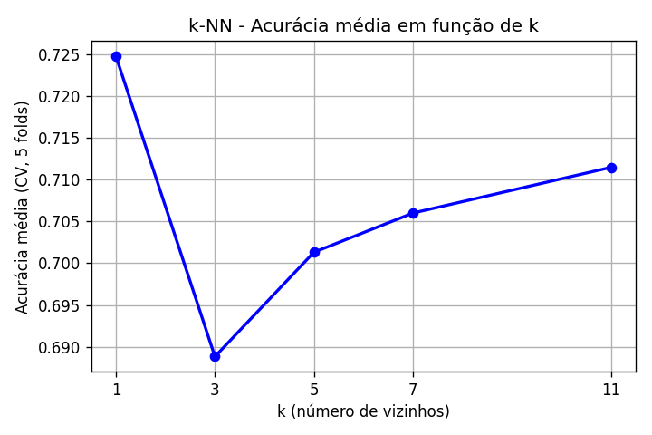

# Problema 3 — Classificação de Qualidade de Vinhos com k-NN

**Disciplina:** PAM0466 – Sistemas Inteligentes (2026.2) — UFERSA, Pau dos Ferros
**Dataset:** [Wine Quality — `winequality-red.csv` (UCI)](https://archive.ics.uci.edu/ml/datasets/Wine+Quality) — 1.599 vinhos tintos e 11 atributos físico-químicos
**Modelo:** `KNeighborsClassifier` (k-NN)

## Como executar

| Arquivo / pasta | Conteúdo                                                        |
| --------------- | --------------------------------------------------------------- |
| `Q3.ipynb`      | Código completo (preparação, escolha de k, avaliação e gráfico) |
| `relatorio.md`  | Este relatório                                                  |
| `imagens/`      | Gráfico gerado pelo código                                      |

Requisitos: Python 3.9+ e conexão com a internet (o dataset é baixado da UCI a cada execução). Funciona em Windows, Linux e macOS.

1. Abra o `Q3.ipynb` no Jupyter ou no VS Code.
2. Execute a primeira célula: `%pip install pandas numpy matplotlib scikit-learn`
3. Execute a célula do código.

## 1. Preparação dos dados

O arquivo usa ponto e vírgula como separador. A variável `quality` (nota de 0 a 10) foi recodificada em três classes:

| Classe | Critério    | Amostras | %     |
| ------ | ----------- | -------- | ----- |
| ruim   | nota ≤ 5    | 744      | 46,5% |
| médio  | nota 6 ou 7 | 837      | 52,3% |
| bom    | nota ≥ 8    | 18       | 1,1%  |

As classes "ruim" e "médio" têm tamanhos parecidos, enquanto "bom" tem apenas 18 amostras (1,1% dos dados).

### Normalização

Foi utilizado o **Z-score** (`StandardScaler`): `z = (x − média) / desvio padrão`, aplicado a todos os atributos.

**Por que a normalização é obrigatória no k-NN?** O k-NN classifica cada ponto pelos vizinhos mais próximos, e a proximidade é medida por distância (euclidiana). Atributos em escalas maiores, como `total sulfur dioxide` (dezenas e centenas), dominariam o cálculo da distância, enquanto atributos em escalas pequenas, como `density` e `chlorides` (centésimos), seriam praticamente ignorados, independentemente de sua importância para a qualidade. Com a normalização, todos os atributos contribuem de forma equilibrada.

Para evitar vazamento de dados (_data leakage_), o normalizador é ajustado apenas com dados de treino: a divisão vem primeiro e o `StandardScaler` fica dentro de um `Pipeline`, sendo reajustado a cada fold da validação cruzada com as amostras de treino daquele fold.

## 2. Divisão treino/teste

Divisão 80% / 20%, **estratificada** pela classe, com `random_state=42`. Treino: 1.279 amostras; teste: 320 amostras.

| Classe | Treino (n) | Treino (%) | Teste (n) | Teste (%) |
| ------ | ---------- | ---------- | --------- | --------- |
| ruim   | 595        | 46,52      | 149       | 46,56     |
| médio  | 670        | 52,38      | 167       | 52,19     |
| bom    | 14         | 1,09       | 4         | 1,25      |

A estratificação manteve a proporção das três classes nos dois conjuntos.

## 3. Treinamento e escolha de k

Validação cruzada estratificada de **5 folds** sobre o conjunto de treino, com a acurácia média como métrica:

| k     | Acurácia média (CV) |
| ----- | ------------------- |
| **1** | **0,7248**          |
| 3     | 0,6888              |
| 5     | 0,7013              |
| 7     | 0,7060              |
| 11    | 0,7115              |

**Melhor valor: k = 1** (acurácia média = 0,7248).

**Nos resultados obtidos:** a curva não é monotônica. A acurácia cai de k = 1 para k = 3 (0,7248 → 0,6888) e depois sobe gradualmente até k = 11 (0,7115). A diferença entre k = 1 e k = 11 é pequena (cerca de 1,3 ponto percentual). Como o maior k testado foi 11, não se observou a queda de desempenho esperada para valores muito altos.

### O que acontece com valores muito baixos e muito altos de k

- **k muito baixo (ex.: k = 1):** cada ponto é classificado pelo único vizinho mais próximo. A fronteira de decisão fica muito irregular e o modelo se ajusta ao ruído e a pontos atípicos do treino (**alta variância, tendência a _overfitting_**).
- **k muito alto:** a vizinhança inclui muitos pontos distantes, de regiões diferentes do espaço de atributos. A fronteira fica excessivamente suave e o modelo tende a prever a classe majoritária (**alto viés, tendência a _underfitting_**). Em um conjunto desbalanceado como este, a classe minoritária é a mais prejudicada, pois seus poucos exemplos são superados em número pelos vizinhos das outras classes.

## 4. Avaliação no conjunto de teste

Modelo final: k = 1, treinado com todo o conjunto de treino e avaliado uma única vez no teste. **Acurácia no teste: 0,7656** (245 acertos em 320).

### Matriz de confusão

|                 | Previsto: ruim | Previsto: médio | Previsto: bom |
| --------------- | -------------- | --------------- | ------------- |
| **Real: ruim**  | 112            | 37              | 0             |
| **Real: médio** | 33             | 133             | 1             |
| **Real: bom**   | 0              | 4               | 0             |

### Métricas por classe

| Classe | Precisão | Recall | F1-score | Suporte |
| ------ | -------- | ------ | -------- | ------- |
| ruim   | 0,7724   | 0,7517 | 0,7619   | 149     |
| médio  | 0,7644   | 0,7964 | 0,7801   | 167     |
| bom    | 0,0000   | 0,0000 | 0,0000   | 4       |

### Entre quais classes o modelo erra com mais frequência?

Entre **ruim** e **médio**: 37 vinhos "ruim" foram previstos como "médio" e 33 vinhos "médio" foram previstos como "ruim". Esses dois erros somam 70 dos 75 erros totais (cerca de 93%). As duas classes são adjacentes na escala de qualidade (a fronteira fica entre as notas 5 e 6), o que dificulta a separação.

A classe **bom** não foi reconhecida: os 4 vinhos dessa classe no teste foram todos previstos como "médio", e o modelo previu "bom" apenas uma vez (um vinho "médio"), erradamente. Por isso precisão, recall e F1 dessa classe são 0. Com apenas 14 amostras no treino e 4 no teste, esses valores são pouco confiáveis e refletem o forte desbalanceamento.

## 5. Conclusão

O k-NN com normalização z-score e k = 1 atingiu 76,6% de acurácia no teste, com desempenho semelhante nas classes "ruim" e "médio" (F1 de 0,76 e 0,78). Os erros se concentram entre essas duas classes vizinhas. A classe "bom", com apenas 18 amostras no dataset, não foi reconhecida.
